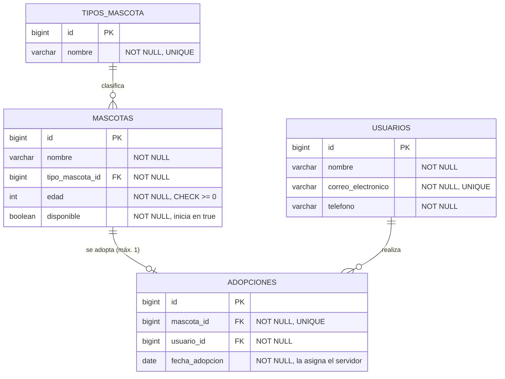

# API-REST-AdopcionCodigoFacilito

API REST para gestionar la adopción de mascotas: registro de mascotas y usuarios adoptantes, consulta de mascotas disponibles y registro de adopciones con reglas de negocio, seguridad HTTP Basic, documentación OpenAPI y pruebas automatizadas.

Proyecto final del Bootcamp de Backend con Java y Spring de Código Facilito.

## Objetivos

- Exponer una API REST organizada en capas, con DTOs de entrada y salida y sin exponer entidades JPA.
- Aplicar las reglas de adopción de forma consistente, incluso ante solicitudes concurrentes.
- Proteger la API con HTTP Basic y dos roles (`USER` y `ADMIN`).
- Responder con códigos HTTP correctos y un formato de error único.
- Exponer hipervínculos HAL (HATEOAS) que reflejan las acciones permitidas por el estado del recurso y el rol.
- Documentar la API con OpenAPI/Swagger UI y monitorearla con Actuator.
- Verificar el comportamiento con pruebas unitarias, de controller y de integración.

## Tecnologías

| Componente | Versión |
|---|---|
| Java | 21 (probado con 21.0.6) |
| Spring Boot | 4.1.2 |
| Spring Framework | 7.0.10 |
| Spring Security | 7.1.2 |
| Spring Data JPA | 4.1.2 |
| Hibernate ORM (proveedor JPA) | 7.4.13.Final |
| Hibernate Validator (Jakarta Bean Validation) | 9.1.5.Final |
| H2 Database (perfiles `dev` y `test`) | 2.4.240 |
| Driver JDBC de PostgreSQL (perfil `postgres`) | 42.7.14 |
| Flyway (migraciones del perfil `postgres`) | 12.4.0 |
| Spring HATEOAS (respuestas HAL) | 3.1.3 |
| springdoc-openapi (Swagger UI 5.34.0) | 3.2.0 |
| Jackson | 3.1.7 |
| Tomcat embebido | 11.0.27 |
| JUnit Jupiter / Mockito | 6.0.3 / 5.23.0 |
| Testcontainers (imagen `postgres:17-alpine`) | 2.0.5 |
| Maven (mediante Maven Wrapper) | 3.9.16 |

## Requisitos

- **JDK 21** instalado y disponible (`java -version`).
- **No hace falta instalar Maven**: el proyecto incluye Maven Wrapper (`mvnw` para Git Bash, `mvnw.cmd` para PowerShell/CMD), que descarga Maven 3.9.16 la primera vez.
- **Docker** (por ejemplo, Docker Desktop en ejecución) **solo** para ejecutar la API en un contenedor, para las pruebas de PostgreSQL (`-Ppostgres`) o para levantar un PostgreSQL local. La API con H2 y las pruebas normales no lo necesitan.

> En Windows, `mvnw.cmd` necesita que `powershell.exe` esté en el `PATH`. Si aparece
> `"powershell" no se reconoce como un comando...` o `Cannot start maven from wrapper`, ver
> [Problemas conocidos en Windows](#problemas-conocidos-en-windows).

## Arquitectura

```
com.codigofacilito.adopcion
├── config       Seguridad, OpenAPI, Clock y propiedades de las cuentas de acceso
├── controller   Solo HTTP: valida la entrada, delega en el servicio y arma la respuesta
│   └── hateoas  Ensambladores de enlaces HAL según el estado del recurso y el rol de la cuenta
├── service      Reglas de negocio y transacciones
├── repository   Interfaces Spring Data JPA
├── entity       Entidades JPA
├── dto          Records de request/response y ErrorResponse
├── mapper       Conversión entidad <-> DTO
└── exception    Excepciones de negocio y @RestControllerAdvice

src/main/resources
├── application*.properties          Configuración general y perfiles dev / postgres
├── data.sql                         Tipos de mascota iniciales (solo H2)
└── db/migration/postgresql/V*.sql   Migraciones Flyway (solo perfil postgres)
```

Flujo: **HTTP → Controller → Service → Repository → Base de datos**. Los controllers nunca acceden a repositories; toda la lógica de negocio vive en los servicios. Se usa inyección por constructor en todas las capas.

## Modelo de datos



- `Mascota → TipoMascota`, `Adopcion → Mascota` y `Adopcion → Usuario` son relaciones `@ManyToOne`.
- La restricción **UNIQUE sobre `adopciones.mascota_id`** impide que una mascota tenga más de una adopción, aunque se omita la validación del servicio.
- Los correos se guardan en minúsculas y sin espacios en los extremos, así la unicidad no distingue mayúsculas.
- Las claves foráneas no tienen borrado en cascada: la base de datos también impide borrar mascotas o usuarios con adopciones.
- Al iniciar se cargan los tipos de mascota desde `data.sql`: **1 Perro, 2 Gato, 3 Conejo, 4 Ave**.

### Reglas de negocio

| Regla | Implementación | HTTP |
|---|---|---|
| No adoptar mascotas o usuarios inexistentes | Búsqueda previa en el servicio | 404 |
| No adoptar mascotas no disponibles | Verificación después de bloquear la mascota | 409 |
| Adopción y `disponible = false` atómicas | Un único método `@Transactional` | — |
| Adopciones concurrentes | Bloqueo pesimista (`SELECT ... FOR UPDATE`) + UNIQUE en BD | 409 |
| Un PUT no puede reactivar una mascota adoptada | Verificación en el servicio con la mascota bloqueada | 409 |
| No eliminar mascotas o usuarios con adopciones | Verificación en el servicio + clave foránea | 409 |
| Correos únicos sin distinguir mayúsculas | Espacios iniciales y finales eliminados antes de validar; minúsculas; verificación + UNIQUE en BD | 409 |

## Ejecución

### Desde IntelliJ IDEA

1. **File → Open** y elegir la carpeta del proyecto (la que contiene `pom.xml`). Aceptar la importación de Maven.
2. **File → Project Structure → Project → SDK**: seleccionar un JDK 21.
3. Abrir `src/main/java/com/codigofacilito/adopcion/AdopcionApplication.java` y pulsar ▶ junto a `main`.
4. La API queda en `http://localhost:8080` con el perfil `dev` (es el perfil por defecto).

Para usar otras credenciales: **Run → Edit Configurations → Environment variables**, por ejemplo
`APP_USER_NAME=operador;APP_USER_PASSWORD=...;APP_ADMIN_NAME=jefe;APP_ADMIN_PASSWORD=...`.

### Desde la terminal

| Acción | PowerShell | Git Bash |
|---|---|---|
| Ejecutar la API (perfil `dev`) | `.\mvnw.cmd spring-boot:run` | `./mvnw spring-boot:run` |
| Pruebas unitarias y de controller | `.\mvnw.cmd clean test` | `./mvnw clean test` |
| Todas las pruebas (incluye integración) | `.\mvnw.cmd clean verify` | `./mvnw clean verify` |
| Generar el JAR | `.\mvnw.cmd clean package` | `./mvnw clean package` |
| Ejecutar el JAR | `java -jar target\adopcion-0.0.1-SNAPSHOT.jar` | `java -jar target/adopcion-0.0.1-SNAPSHOT.jar` |

Para detener la aplicación: `Ctrl + C` en la terminal donde se está ejecutando.

> ⚠️ **Los datos no se conservan.** H2 corre en memoria y Hibernate usa `ddl-auto=create-drop`:
> al reiniciar la aplicación se pierden todos los registros y solo se recargan los tipos de mascota.
> Por eso, con la aplicación recién iniciada, los ids de mascotas, usuarios y adopciones empiezan en 1.

### Con Docker

El `Dockerfile` usa dos etapas:

- **Compilación:** usa `maven:3.9.16-eclipse-temurin-21` y genera el JAR ejecutable con `mvn -DskipTests package`. **Las pruebas no se ejecutan al construir la imagen**, para no requerir base de datos ni Docker dentro de la construcción; se ejecutan aparte con `mvnw verify` (ver [Pruebas](#pruebas)).
- **Ejecución:** usa `eclipse-temurin:21-jre-noble`, con un usuario sin privilegios (`adopcion`, uid 10001), `EXPOSE 8080` y `ENTRYPOINT` en formato exec.

La imagen no contiene credenciales ni archivos `.env`: el perfil se elige con `SPRING_PROFILES_ACTIVE` y la configuración se pasa al ejecutar el contenedor con `--env-file`. El `.dockerignore` excluye, entre otros, `.git`, `target`, los archivos `.env*`, los certificados y las claves privadas.

Requiere Docker Desktop en ejecución. Los comandos son iguales en PowerShell y Git Bash salvo donde se indica, y se ejecutan desde la carpeta raíz del proyecto.

**1. Construir la imagen**

```bash
docker build -t api-rest-adopcion .
```

**2. Crear el archivo de configuración local**

Los archivos `.env.*` están en `.gitignore` (excepto `.env.example`), así que no se suben al repositorio.

- **Con H2 (perfil `dev`):**

  ```powershell
  # PowerShell
  Set-Content -Path .env.h2 -Value "SPRING_PROFILES_ACTIVE=dev" -Encoding ascii
  ```

  ```bash
  # Git Bash
  printf 'SPRING_PROFILES_ACTIVE=dev\n' > .env.h2
  ```

  El perfil `dev` usa las credenciales de demostración (`user`/`user123` y `admin`/`admin123`). Para cambiarlas, agregar líneas `APP_USER_NAME=...`, etc.

- **Con PostgreSQL (perfil `postgres`):** copiar la plantilla (`Copy-Item .env.example .env.postgres` en PowerShell, `cp .env.example .env.postgres` en Git Bash) y completar los valores. En un `--env-file` los valores van **sin comillas** y no admiten comentarios al final de la línea.

**3. Levantar el contenedor en segundo plano**

```bash
docker run -d --name adopcion-api --env-file .env.h2 -p 127.0.0.1:8080:8080 api-rest-adopcion
```

`-p 127.0.0.1:8080:8080` publica el puerto solo en el equipo local. Para PostgreSQL, usar `--env-file .env.postgres`.

**4. Comprobar que funciona**

```bash
# Git Bash
curl http://localhost:8080/actuator/health
curl -i http://localhost:8080/api/mascotas                      # 401 sin credenciales
curl -u user:user123 http://localhost:8080/api/mascotas         # 200
```

```powershell
# PowerShell
curl.exe http://localhost:8080/actuator/health
curl.exe -i http://localhost:8080/api/mascotas
curl.exe -u user:user123 http://localhost:8080/api/mascotas
```

Swagger UI queda en <http://localhost:8080/swagger-ui.html>. Con el perfil `dev`, la consola H2 queda en <http://localhost:8080/h2-console>.

**5. Logs, detener y eliminar**

```bash
docker logs -f adopcion-api     # ver logs (Ctrl + C deja de seguirlos; el contenedor sigue activo)
docker stop adopcion-api        # detener
docker rm adopcion-api          # eliminar
```

> ⚠️ **Con H2 los datos viven solo mientras dura el proceso.** Al reiniciar (`docker restart`),
> detener o eliminar el contenedor, se pierden todos los registros. Con el perfil `postgres` los datos
> están en la base externa y se conservan aunque se elimine el contenedor de la API.

#### PostgreSQL desde el contenedor

**`localhost` dentro del contenedor es el propio contenedor, no Windows.** Con `DB_URL=jdbc:postgresql://localhost:...` la conexión es rechazada.

- **PostgreSQL en el equipo (Windows o un contenedor publicado en el host) con Docker Desktop:** usar `host.docker.internal`. Por ejemplo, para el PostgreSQL local de la [sección anterior](#postgresql-local-con-docker-verificado), el archivo `.env.postgres` quedaría así:

  ```
  SPRING_PROFILES_ACTIVE=postgres
  DB_URL=jdbc:postgresql://host.docker.internal:55432/postgres
  DB_USERNAME=postgres
  DB_PASSWORD=clave-local
  DB_POOL_SIZE=5
  DB_LOCK_TIMEOUT=5s
  APP_USER_NAME=user
  APP_USER_PASSWORD=user123
  APP_ADMIN_NAME=admin
  APP_ADMIN_PASSWORD=admin123
  ```

  Las variables opcionales `SPRING_FLYWAY_URL`, `SPRING_FLYWAY_USER` y `SPRING_FLYWAY_PASSWORD` se agregan al mismo archivo si las migraciones deben usar otra conexión.

- **Supabase (preparado, no verificado):** usar en `DB_URL` el host, puerto y usuario exactos del panel (ver [Supabase](#supabase-preparado-no-verificado)). El certificado CA **no se copia a la imagen**: se monta como archivo de solo lectura y se referencia con su ruta **dentro** del contenedor:

  ```
  DB_URL=jdbc:postgresql://<HOST_DEL_POOLER>:<PUERTO>/postgres?sslmode=verify-full&sslrootcert=/certs/supabase-ca.crt
  ```

  ```powershell
  # PowerShell
  docker run -d --name adopcion-api --env-file .env.postgres -p 127.0.0.1:8080:8080 `
    -v "C:/ruta/al/certificado-ca.crt:/certs/supabase-ca.crt:ro" api-rest-adopcion
  ```

  ```bash
  # Git Bash
  docker run -d --name adopcion-api --env-file .env.postgres -p 127.0.0.1:8080:8080 \
    -v "C:/ruta/al/certificado-ca.crt:/certs/supabase-ca.crt:ro" api-rest-adopcion
  ```

  Si Git Bash transforma las rutas que empiezan con `/` (síntoma: el archivo no aparece en `/certs`), anteponer `MSYS_NO_PATHCONV=1` al comando.

## Perfiles y credenciales

| Perfil | Cuándo se usa | Base de datos | Consola H2 | Cuentas de acceso |
|---|---|---|---|---|
| `dev` | Por defecto al ejecutar localmente | H2 en memoria `jdbc:h2:mem:adopciondb` | Habilitada (solo ADMIN) | Valores de demostración o variables de entorno |
| `test` | Automáticamente en las pruebas | H2 en memoria con nombre aleatorio por contexto | Deshabilitada | `test-user` / `test-admin` (solo pruebas) |
| `postgres` | `SPRING_PROFILES_ACTIVE=postgres` | PostgreSQL (`DB_URL`), schema `adopcion`, Flyway, datos persistentes | Deshabilitada | **Obligatorio** definir las variables de entorno |
| Otro (ej. `prod`) | `--spring.profiles.active=prod` | H2 en memoria | Deshabilitada | **Obligatorio** definir las variables de entorno |

Las **cuentas de acceso** autentican a quien opera la API (por ejemplo, el personal del refugio). **No son los usuarios adoptantes**: estos son datos de la entidad `Usuario` y no tienen contraseña.

| Variable de entorno | Valor de demostración en `dev` | Rol |
|---|---|---|
| `APP_USER_NAME` / `APP_USER_PASSWORD` | `user` / `user123` | `USER` |
| `APP_ADMIN_NAME` / `APP_ADMIN_PASSWORD` | `admin` / `admin123` | `USER` y `ADMIN` |

- Los valores de demostración **solo existen en el perfil `dev`** y son exclusivamente para uso local.
- Fuera de `dev` no hay valores por defecto: si falta alguna variable, la aplicación no arranca e indica cuál.
- Las contraseñas se codifican con BCrypt (`PasswordEncoder`) al iniciar; nunca se guardan en texto plano.

Ejemplo con credenciales propias y un perfil distinto de `dev`:

```powershell
# PowerShell
$env:APP_USER_NAME = "operador"; $env:APP_USER_PASSWORD = "una-clave-segura"
$env:APP_ADMIN_NAME = "jefe";    $env:APP_ADMIN_PASSWORD = "otra-clave-segura"
java -jar target\adopcion-0.0.1-SNAPSHOT.jar --spring.profiles.active=prod
```

```bash
# Git Bash
APP_USER_NAME=operador APP_USER_PASSWORD=una-clave-segura \
APP_ADMIN_NAME=jefe APP_ADMIN_PASSWORD=otra-clave-segura \
java -jar target/adopcion-0.0.1-SNAPSHOT.jar --spring.profiles.active=prod
```

## Endpoints

Todos los endpoints `/api/**` requieren HTTP Basic. `401` = credenciales ausentes o incorrectas; `403` = la cuenta no tiene el rol requerido.

| Método | Ruta | Rol | Éxito | Errores |
|---|---|---|---|---|
| POST | `/api/mascotas` | ADMIN | 201 + `Location` | 400, 401, 403, 404 (tipo inexistente) |
| GET | `/api/mascotas` | USER o ADMIN | 200 (solo disponibles) | 401 |
| GET | `/api/mascotas/{id}` | USER o ADMIN | 200 | 400, 401, 404 |
| PUT | `/api/mascotas/{id}` | ADMIN | 200 | 400, 401, 403, 404, 409 (reactivar adoptada) |
| DELETE | `/api/mascotas/{id}` | ADMIN | 204 | 401, 403, 404, 409 (tiene adopción) |
| POST | `/api/usuarios` | USER o ADMIN | 201 + `Location` | 400, 401, 409 (correo duplicado) |
| GET | `/api/usuarios` | USER o ADMIN | 200 | 401 |
| GET | `/api/usuarios/{id}` | USER o ADMIN | 200 | 400, 401, 404 |
| PUT | `/api/usuarios/{id}` | USER o ADMIN | 200 | 400, 401, 404, 409 (correo de otro usuario) |
| DELETE | `/api/usuarios/{id}` | ADMIN | 204 | 401, 403, 404, 409 (tiene adopciones) |
| POST | `/api/adopciones` | USER o ADMIN | 201 + `Location` | 400, 401, 404, 409 (no disponible) |
| GET | `/api/adopciones/{id}` | USER o ADMIN | 200 | 400, 401, 404 |

Los endpoints `GET /api/mascotas/{id}` y `GET /api/adopciones/{id}` existen para que el header `Location` de los `201` apunte a un recurso consultable. Cualquier error inesperado responde `500` sin detalles internos.

### Formato HAL (HATEOAS)

Las respuestas exitosas usan **HAL** con Spring HATEOAS:

- **Media type:** `application/hal+json` (es lo que se recibe con curl, Swagger UI o cualquier cliente que acepte `*/*`). Si el cliente envía `Accept: application/json`, el cuerpo es el mismo y solo cambia el `Content-Type`.
- **Recursos:** los campos del DTO más un objeto `_links`.
- **Listas:** objeto con `_embedded.mascotas` o `_embedded.usuarios` y `_links.self`. **Ya no son arrays JSON.**
- **Listas vacías:** HAL omite `_embedded`, así que la respuesta es solo `{"_links":{"self":{...}}}`. Un cliente debe tratar la ausencia de `_embedded` como lista vacía.
- **Errores:** no cambian. Siguen siendo `application/json` con el formato `ErrorResponse` y sin `_links`, aunque el cliente pida `application/hal+json`.
- El `Location` de los `201` coincide con `_links.self.href`.

**Relaciones** (los enlaces HAL no indican el método HTTP; se documenta aquí):

| Recurso | Relación | Método y destino | Aparece cuando |
|---|---|---|---|
| Mascota | `self` | GET `/api/mascotas/{id}` | siempre |
| | `mascotas-disponibles` | GET `/api/mascotas` | siempre |
| | `adoptar` | POST `/api/adopciones` (cuerpo `{"mascotaId", "usuarioId"}`) | la mascota está disponible y no tiene adopción |
| | `adopcion` | GET `/api/adopciones/{id}` | la mascota tiene adopción (no se calcula en las listas: allí todas están disponibles) |
| | `actualizar` | PUT `/api/mascotas/{id}` | la cuenta es ADMIN |
| | `eliminar` | DELETE `/api/mascotas/{id}` | la cuenta es ADMIN y la mascota no tiene adopción |
| Usuario | `self` | GET `/api/usuarios/{id}` | siempre |
| | `usuarios` | GET `/api/usuarios` | siempre |
| | `actualizar` | PUT `/api/usuarios/{id}` | siempre (USER y ADMIN pueden actualizar) |
| | `eliminar` | DELETE `/api/usuarios/{id}` | la cuenta es ADMIN y el usuario no tiene adopciones; **solo en el detalle**, no en la lista (para no consultar adopciones por cada usuario) |
| Adopción | `self` | GET `/api/adopciones/{id}` | siempre |
| | `mascota` | GET `/api/mascotas/{id}` | siempre |
| | `usuario` | GET `/api/usuarios/{id}` | siempre |
| Listas | `self` | GET de la propia lista | siempre |

No hay enlaces a operaciones que no existen (listar o eliminar adopciones, adopciones de un usuario, tipos de mascota).

> **Los enlaces no reemplazan la autorización ni las reglas de negocio.** Son una guía para el cliente
> según el estado y el rol **en el momento de la respuesta**. El servidor vuelve a verificar todo en
> cada solicitud: una cuenta USER que invoque `DELETE` sin tener el enlace recibe `403`, y un enlace
> `adoptar` obtenido antes de que otra solicitud adoptara la mascota termina en `409`.

### Formato de error

Todas las respuestas de error, incluidas `401` y `403`, usan el mismo formato (`application/json`):

```json
{
  "timestamp": "2026-10-27T16:27:51.181557600Z",
  "status": 400,
  "error": "Bad Request",
  "message": "La solicitud contiene datos inválidos",
  "path": "/api/usuarios",
  "details": [
    { "field": "correoElectronico", "message": "El correo electrónico no tiene un formato válido" },
    { "field": "telefono", "message": "El teléfono debe tener entre 7 y 20 caracteres: dígitos, espacios, paréntesis, guiones y un + inicial opcional" },
    { "field": "nombre", "message": "El nombre es obligatorio" }
  ]
}
```

`details` solo tiene contenido en errores de validación; en los demás casos es una lista vacía. Nunca se envían trazas de excepciones al cliente.

## Ejemplos con curl

Los cuerpos de las solicitudes están en la carpeta [`ejemplos/`](ejemplos) y se envían con `--data-binary "@archivo"`. Así los mismos comandos funcionan en Git Bash y en PowerShell sin problemas de comillas.

- **Git Bash:** usar `curl`.
- **PowerShell:** usar **`curl.exe`**. En Windows PowerShell 5.1, `curl` es un alias de `Invoke-WebRequest` y no acepta estas opciones. Escribir `"@ejemplos/..."` entre comillas, porque `@` tiene significado especial en PowerShell.

Todos los comandos se ejecutan desde la carpeta raíz del proyecto, con la aplicación iniciada en el perfil `dev` y recién arrancada. Las respuestas se muestran con formato para facilitar la lectura; la API las envía en una sola línea.

### Demostración completa

**1. Registrar un usuario adoptante** (`ejemplos/usuario.json`)

```bash
# Git Bash
curl -i -u user:user123 -H "Content-Type: application/json" --data-binary @ejemplos/usuario.json http://localhost:8080/api/usuarios
```

```powershell
# PowerShell
curl.exe -i -u user:user123 -H "Content-Type: application/json" --data-binary "@ejemplos/usuario.json" http://localhost:8080/api/usuarios
```

```http
HTTP/1.1 201
Location: http://localhost:8080/api/usuarios/1
Content-Type: application/hal+json

{
  "_links": {
    "self": { "href": "http://localhost:8080/api/usuarios/1" },
    "usuarios": { "href": "http://localhost:8080/api/usuarios" },
    "actualizar": { "href": "http://localhost:8080/api/usuarios/1" }
  },
  "id": 1,
  "nombre": "Ana Pérez",
  "correoElectronico": "ana.perez@mail.com",
  "telefono": "+54 11 5555-1234"
}
```

La respuesta usa la cuenta `user`, por eso no incluye `eliminar` (solo ADMIN puede eliminar usuarios).

**2. Registrar una mascota** (requiere ADMIN; `ejemplos/mascota.json`)

```bash
# Git Bash
curl -i -u admin:admin123 -H "Content-Type: application/json" --data-binary @ejemplos/mascota.json http://localhost:8080/api/mascotas
```

```powershell
# PowerShell
curl.exe -i -u admin:admin123 -H "Content-Type: application/json" --data-binary "@ejemplos/mascota.json" http://localhost:8080/api/mascotas
```

```http
HTTP/1.1 201
Location: http://localhost:8080/api/mascotas/1
Content-Type: application/hal+json

{
  "_links": {
    "self": { "href": "http://localhost:8080/api/mascotas/1" },
    "mascotas-disponibles": { "href": "http://localhost:8080/api/mascotas" },
    "adoptar": { "href": "http://localhost:8080/api/adopciones" },
    "actualizar": { "href": "http://localhost:8080/api/mascotas/1" },
    "eliminar": { "href": "http://localhost:8080/api/mascotas/1" }
  },
  "id": 1,
  "nombre": "Firulais",
  "tipoMascota": { "id": 1, "nombre": "Perro" },
  "edad": 3,
  "disponible": true
}
```

**3. Consultar las mascotas disponibles** (como `user`: sin `actualizar` ni `eliminar`)

```bash
curl -u user:user123 http://localhost:8080/api/mascotas          # Git Bash
curl.exe -u user:user123 http://localhost:8080/api/mascotas      # PowerShell
```

```json
{
  "_embedded": {
    "mascotas": [
      {
        "_links": {
          "self": { "href": "http://localhost:8080/api/mascotas/1" },
          "mascotas-disponibles": { "href": "http://localhost:8080/api/mascotas" },
          "adoptar": { "href": "http://localhost:8080/api/adopciones" }
        },
        "id": 1,
        "nombre": "Firulais",
        "tipoMascota": { "id": 1, "nombre": "Perro" },
        "edad": 3,
        "disponible": true
      }
    ]
  },
  "_links": {
    "self": { "href": "http://localhost:8080/api/mascotas" }
  }
}
```

**4. Adoptar la mascota** con el enlace `adoptar` (`ejemplos/adopcion.json`: `{"mascotaId": 1, "usuarioId": 1}`)

```bash
# Git Bash
curl -i -u user:user123 -H "Content-Type: application/json" --data-binary @ejemplos/adopcion.json http://localhost:8080/api/adopciones
```

```powershell
# PowerShell
curl.exe -i -u user:user123 -H "Content-Type: application/json" --data-binary "@ejemplos/adopcion.json" http://localhost:8080/api/adopciones
```

```http
HTTP/1.1 201
Location: http://localhost:8080/api/adopciones/1
Content-Type: application/hal+json

{
  "_links": {
    "self": { "href": "http://localhost:8080/api/adopciones/1" },
    "mascota": { "href": "http://localhost:8080/api/mascotas/1" },
    "usuario": { "href": "http://localhost:8080/api/usuarios/1" }
  },
  "id": 1,
  "fechaAdopcion": "2026-10-27",
  "mascota": { "id": 1, "nombre": "Firulais", "tipoMascota": { "id": 1, "nombre": "Perro" }, "edad": 3, "disponible": false },
  "usuario": { "id": 1, "nombre": "Ana Pérez", "correoElectronico": "ana.perez@mail.com", "telefono": "+54 11 5555-1234" }
}
```

**5. Comprobar que ya no aparece entre las disponibles** (lista vacía: sin `_embedded`)

```bash
curl -u user:user123 http://localhost:8080/api/mascotas          # Git Bash
curl.exe -u user:user123 http://localhost:8080/api/mascotas      # PowerShell
```

```json
{
  "_links": {
    "self": { "href": "http://localhost:8080/api/mascotas" }
  }
}
```

**6. Intentar adoptarla otra vez** (mismo comando del paso 4)

```http
HTTP/1.1 409
Content-Type: application/json

{"timestamp":"2026-10-27T17:46:09.267772249Z","status":409,"error":"Conflict","message":"La mascota con id 1 ya fue adoptada o no está disponible","path":"/api/adopciones","details":[]}
```

**7. Consultar la mascota adoptada como ADMIN** (`curl -u admin:admin123 http://localhost:8080/api/mascotas/1`): ahora enlaza su adopción y ya no ofrece `adoptar` ni `eliminar`.

```json
{
  "_links": {
    "self": { "href": "http://localhost:8080/api/mascotas/1" },
    "mascotas-disponibles": { "href": "http://localhost:8080/api/mascotas" },
    "adopcion": { "href": "http://localhost:8080/api/adopciones/1" },
    "actualizar": { "href": "http://localhost:8080/api/mascotas/1" }
  },
  "id": 1,
  "nombre": "Firulais",
  "tipoMascota": { "id": 1, "nombre": "Perro" },
  "edad": 3,
  "disponible": false
}
```

Del mismo modo, `curl -u admin:admin123 http://localhost:8080/api/usuarios/1` ya no incluye `eliminar`, porque el usuario tiene una adopción.

### Otros ejemplos

Los comandos usan la sintaxis de Git Bash. En PowerShell, reemplazar `curl` por `curl.exe` y escribir el archivo como `"@ejemplos/..."`.

| Caso | Comando | Respuesta |
|---|---|---|
| Sin credenciales | `curl -i http://localhost:8080/api/mascotas` | `401` + `WWW-Authenticate: Basic realm="adopcion-api"` |
| Rol insuficiente | `curl -i -u user:user123 -H "Content-Type: application/json" --data-binary @ejemplos/mascota.json http://localhost:8080/api/mascotas` | `403` |
| Datos inválidos | `curl -i -u user:user123 -H "Content-Type: application/json" --data-binary @ejemplos/usuario-invalido.json http://localhost:8080/api/usuarios` | `400` con `details` |
| Correo duplicado | repetir el paso 1 | `409` |
| Reactivar una adoptada | `curl -i -u admin:admin123 -X PUT -H "Content-Type: application/json" --data-binary @ejemplos/mascota-reactivar.json http://localhost:8080/api/mascotas/1` | `409` |
| Actualizar una mascota | `curl -i -u admin:admin123 -X PUT -H "Content-Type: application/json" --data-binary @ejemplos/mascota-actualizacion.json http://localhost:8080/api/mascotas/{id}` | `200` |
| Listar usuarios | `curl -u user:user123 http://localhost:8080/api/usuarios` | `200` (`_embedded.usuarios`) |
| Consultar un usuario | `curl -u user:user123 http://localhost:8080/api/usuarios/1` | `200` |
| Actualizar un usuario | `curl -i -u user:user123 -X PUT -H "Content-Type: application/json" --data-binary @ejemplos/usuario-actualizacion.json http://localhost:8080/api/usuarios/1` | `200` |
| Consultar una adopción | `curl -u user:user123 http://localhost:8080/api/adopciones/1` | `200` |
| Recurso inexistente | `curl -i -u user:user123 http://localhost:8080/api/mascotas/99` | `404` |
| Eliminar una mascota con adopción | `curl -i -u admin:admin123 -X DELETE http://localhost:8080/api/mascotas/1` | `409` |
| Eliminar una mascota sin adopción | `curl -i -u admin:admin123 -X DELETE http://localhost:8080/api/mascotas/{id}` | `204` |
| Eliminar un usuario con adopciones | `curl -i -u admin:admin123 -X DELETE http://localhost:8080/api/usuarios/1` | `409` |
| Eliminar usuario con rol USER | `curl -i -u user:user123 -X DELETE http://localhost:8080/api/usuarios/1` | `403` |

Respuesta de `PUT /api/usuarios/1` con `ejemplos/usuario-actualizacion.json`:

```json
{
  "_links": {
    "self": { "href": "http://localhost:8080/api/usuarios/1" },
    "usuarios": { "href": "http://localhost:8080/api/usuarios" },
    "actualizar": { "href": "http://localhost:8080/api/usuarios/1" }
  },
  "id": 1,
  "nombre": "Ana María Pérez",
  "correoElectronico": "ana.perez@mail.com",
  "telefono": "+54 11 4444-0000"
}
```

**Correo electrónico:** al crear y actualizar se eliminan los espacios iniciales y finales **antes** de validar y de buscar duplicados (por ejemplo, `"  ana.perez@mail.com "` se acepta y se guarda sin espacios). Un correo con espacios internos (`"ana perez@mail.com"`) se rechaza con `400`. Como hasta ahora, se guarda en minúsculas y la unicidad no distingue mayúsculas.

## Swagger UI y OpenAPI

| Recurso | URL | Acceso |
|---|---|---|
| Swagger UI | <http://localhost:8080/swagger-ui.html> (redirige a `/swagger-ui/index.html`) | Público |
| Documento OpenAPI (JSON) | <http://localhost:8080/v3/api-docs> | Público |

La documentación es pública, pero **los endpoints de negocio siguen protegidos**: Swagger UI solo envía las credenciales que se cargan con **Authorize**. Cada operación indica en su descripción el rol requerido (`USER` o `ADMIN`) y documenta sus respuestas de error con el esquema `ErrorResponse` (`application/json`). Las respuestas exitosas se documentan como `application/hal+json`, con esquemas `EntityModel...` (campos más `_links`) y `CollectionModel...` (`_embedded` más `_links`); la descripción general del documento lista las relaciones.

Para probar la API desde Swagger UI:

1. Abrir <http://localhost:8080/swagger-ui.html>.
2. Pulsar **Authorize** (candado arriba a la derecha).
3. En `basicAuth (http, Basic)` escribir `user` / `user123` (o `admin` / `admin123` para operaciones de ADMIN) y pulsar **Authorize** y luego **Close**.
4. Expandir una operación, pulsar **Try it out**, completar el cuerpo y pulsar **Execute**.
5. Para cambiar de cuenta: **Authorize → Logout** y volver a autorizar.

> Autorizar **antes** de usar *Try it out*. Si se ejecuta una operación sin autorizar, el navegador
> puede mostrar su propio diálogo de usuario y contraseña (por el header `WWW-Authenticate`).
> Conviene **cancelarlo** y usar Authorize: ver la [limitación de CSRF](#http-basic-https-y-csrf).

## Actuator

Solo se exponen por HTTP `health` e `info`, ambos públicos:

| URL | Respuesta |
|---|---|
| <http://localhost:8080/actuator/health> | `{"status":"UP"}` (sin componentes ni detalles internos) |
| <http://localhost:8080/actuator/info> | `{"app":{"name":"API-REST-AdopcionCodigoFacilito","description":"API REST para la adopción de mascotas","version":"0.0.1-SNAPSHOT"}}` |

Los demás endpoints (`env`, `beans`, `mappings`, `heapdump`, `configprops`, `loggers`, `metrics`, etc.) no están expuestos, y además la seguridad los rechaza (`401` sin credenciales, `403` con credenciales). El nombre y la versión de `info` se toman del `pom.xml` al compilar.

## Consola H2

Disponible solo en el perfil `dev`:

1. Abrir <http://localhost:8080/h2-console>. El navegador pide credenciales: usar la cuenta **ADMIN** (`admin` / `admin123`).
2. En el formulario de H2:
   - **JDBC URL:** `jdbc:h2:mem:adopciondb`
   - **User Name:** `sa`
   - **Password:** (vacío)
3. Pulsar **Connect**. Consultas útiles:

```sql
SELECT * FROM TIPOS_MASCOTA;
SELECT * FROM MASCOTAS;
SELECT * FROM USUARIOS;
SELECT * FROM ADOPCIONES;
```

La consola tiene su propia cadena de seguridad que exige el rol ADMIN. Solo para sus rutas se permite que el sitio se muestre en frames del mismo origen y se desactiva CSRF, porque la consola usa formularios y frames propios. Con la cuenta USER responde `403`, y en los perfiles distintos de `dev` no existe.

## PostgreSQL y Supabase (perfil `postgres`)

El perfil `postgres` conecta la API a un PostgreSQL con datos persistentes:

- **Esquema propio `adopcion`**: JPA (`hibernate.default_schema`) y Flyway (`default-schema`, `schemas`) usan el mismo schema; no se crean tablas en `public`.
- **Migraciones versionadas** en `src/main/resources/db/migration/postgresql`:
  - `V1__crear_esquema.sql`: tablas, restricciones con nombre (`uk_usuario_correo`, `uk_adopcion_mascota`, `ck_mascota_edad`, claves foráneas sin cascada) e índices de las claves foráneas.
  - `V2__tipos_mascota_iniciales.sql`: Perro, Gato, Conejo y Ave con `ON CONFLICT (nombre) DO NOTHING`. Flyway la ejecuta una sola vez; el `ON CONFLICT` evita duplicados si los tipos ya existían.
  - `V3__restringir_acceso_externo.sql`: quita todo acceso al schema a los roles `anon` y `authenticated` de Supabase (si existen) y activa RLS sin políticas en las cuatro tablas. La aplicación conecta con el rol dueño de las tablas, al que RLS no afecta.
- **`ddl-auto=validate`**: Hibernate nunca crea ni modifica tablas; si las entidades y las migraciones no coinciden, la aplicación no arranca.
- **`data.sql` no se ejecuta** (`spring.sql.init.mode=never`): solo se usa con H2.
- **`lock_timeout`** (por defecto 5 s, variable `DB_LOCK_TIMEOUT`): si una adopción espera un bloqueo más que eso, responde `409` ("intente nuevamente") en lugar de esperar indefinidamente.

H2 sigue siendo la base de los perfiles `dev` y `test`; Flyway está desactivado fuera del perfil `postgres`.

### Variables de entorno

Ver la plantilla [`.env.example`](.env.example) (sin valores reales). Spring Boot **no** lee archivos `.env` por sí solo: definir las variables en la terminal o en la Run Configuration de IntelliJ.

| Variable | Descripción |
|---|---|
| `SPRING_PROFILES_ACTIVE` | `postgres` |
| `DB_URL` | URL JDBC: `jdbc:postgresql://<host>:<puerto>/<base>?<parámetros>` (sin usuario ni contraseña) |
| `DB_USERNAME` / `DB_PASSWORD` | Credenciales de la base |
| `DB_POOL_SIZE` | Máximo de conexiones del pool (por defecto 5) |
| `DB_LOCK_TIMEOUT` | Espera máxima de un bloqueo (por defecto `5s`) |
| `SPRING_FLYWAY_URL` / `SPRING_FLYWAY_USER` / `SPRING_FLYWAY_PASSWORD` | Opcional: conexión distinta para las migraciones. Si se define la URL, hay que definir también usuario y contraseña: Flyway no reutiliza los de `DB_*` |
| `APP_USER_*` / `APP_ADMIN_*` | Cuentas de acceso a la API (obligatorias) |

### PostgreSQL local con Docker (verificado)

```powershell
# PowerShell
docker run -d --rm --name adopcion-postgres -e POSTGRES_PASSWORD=clave-local -p 127.0.0.1:55432:5432 postgres:17-alpine
.\mvnw.cmd clean package -DskipTests
$env:SPRING_PROFILES_ACTIVE = "postgres"
$env:DB_URL = "jdbc:postgresql://localhost:55432/postgres"
$env:DB_USERNAME = "postgres"; $env:DB_PASSWORD = "clave-local"
$env:APP_USER_NAME = "user";   $env:APP_USER_PASSWORD = "user123"
$env:APP_ADMIN_NAME = "admin"; $env:APP_ADMIN_PASSWORD = "admin123"
java -jar target\adopcion-0.0.1-SNAPSHOT.jar
# Al terminar: Ctrl + C y luego
docker stop adopcion-postgres
```

```bash
# Git Bash
docker run -d --rm --name adopcion-postgres -e POSTGRES_PASSWORD=clave-local -p 127.0.0.1:55432:5432 postgres:17-alpine
./mvnw clean package -DskipTests
SPRING_PROFILES_ACTIVE=postgres DB_URL=jdbc:postgresql://localhost:55432/postgres \
DB_USERNAME=postgres DB_PASSWORD=clave-local \
APP_USER_NAME=user APP_USER_PASSWORD=user123 APP_ADMIN_NAME=admin APP_ADMIN_PASSWORD=admin123 \
java -jar target/adopcion-0.0.1-SNAPSHOT.jar
docker stop adopcion-postgres
```

En el primer arranque el log muestra `Successfully applied 3 migrations to schema "adopcion"`; en los siguientes, `Schema "adopcion" is up to date`. Los datos se conservan entre reinicios de la aplicación mientras el contenedor siga activo (`--rm` lo elimina al detenerlo). Las credenciales de este ejemplo son solo para uso local.

### Supabase (preparado, **no verificado**)

> La configuración está preparada siguiendo la documentación de Supabase, pero **no se probó contra un
> proyecto real de Supabase**. La conectividad depende también de tu red, DNS, firewall y de los
> permisos del proyecto.

1. **Elegir la conexión** en el panel del proyecto (**Connect**). Usar el host, puerto y usuario **exactos** que muestre el panel:
   - **Pooler compartido en modo session** (configuración recomendada para este proyecto): accesible por IPv4. El usuario tiene la forma `postgres.<project-ref>`.
   - **Conexión directa**: según Supabase, en los planes Free y Pro es solo IPv6, salvo que se contrate el complemento IPv4. Supabase la recomienda para migraciones si hay conectividad.
   - **No usar el pooler en modo transaction** (puerto 6543): no soporta prepared statements y pierde la configuración de sesión (`lock_timeout`) y los bloqueos de sesión que usa Flyway para coordinar migraciones.
2. **SSL**: descargar el certificado CA desde *Database Settings → SSL Configuration*, guardarlo **fuera del repositorio** (los `.crt` están en `.gitignore`) y usar `sslmode=verify-full`, que cifra la conexión y verifica la autoridad certificadora y el nombre del host. `sslmode=require` solo cifra y no verifica el servidor. Supabase no exige SSL por defecto; se puede forzar desde la misma sección (el cambio reinicia la base).
3. **Definir las variables**, por ejemplo en PowerShell (reemplazar los valores entre `< >` con los del panel; la ruta del certificado con `/`):

   ```powershell
   $env:SPRING_PROFILES_ACTIVE = "postgres"
   $env:DB_URL = "jdbc:postgresql://<HOST_DEL_POOLER>:<PUERTO>/postgres?sslmode=verify-full&sslrootcert=C:/ruta/al/certificado-ca.crt"
   $env:DB_USERNAME = "<USUARIO_DEL_POOLER>"
   $env:DB_PASSWORD = "<CLAVE_DE_LA_BASE>"
   # además APP_USER_* y APP_ADMIN_*
   java -jar target\adopcion-0.0.1-SNAPSHOT.jar
   ```

4. **Migraciones por conexión directa** (opcional, si hay conectividad IPv6 o complemento IPv4): definir `SPRING_FLYWAY_URL`, `SPRING_FLYWAY_USER` y `SPRING_FLYWAY_PASSWORD` con los datos de la conexión directa. Si no, Flyway usa la misma conexión del pooler en modo session, que mantiene la sesión durante toda la conexión.
5. **API de datos de Supabase**: la aplicación solo necesita JDBC. El schema `adopcion` no debe agregarse a los *Exposed schemas* de la Data API; la migración V3 además revoca el acceso de `anon` y `authenticated` y activa RLS como defensa adicional. Conviene confirmarlo en el panel después de migrar.

## HTTP Basic, HTTPS y CSRF

- **HTTP Basic no cifra las credenciales**: solo las codifica en Base64 en el header `Authorization`, así que cualquiera que intercepte el tráfico puede leerlas. **Fuera del entorno local es obligatorio usar HTTPS.** Esta configuración sirve solo para desarrollo y evaluación.
- La API no usa sesión HTTP (`STATELESS`): cada solicitud debe incluir sus credenciales.
- **CSRF está desactivado en `/api/**`.** La API está pensada para **clientes que envían el header `Authorization` de forma explícita** en cada solicitud: curl, Postman, Swagger UI (con Authorize) u otro backend. Un sitio externo no puede agregar ese header por cuenta del usuario.
- **Limitación en navegadores:** `STATELESS` por sí solo **no elimina** el riesgo de CSRF. Si alguien se autentica con el diálogo nativo del navegador, este guarda las credenciales Basic y las reenvía automáticamente, también en solicitudes iniciadas desde otro sitio. Por eso la API no debe usarse desde un navegador con ese diálogo. Un frontend web propio requeriría reactivar CSRF o migrar a tokens enviados explícitamente (por ejemplo JWT u OAuth2).

## Pruebas

| Tipo | Ubicación | Herramientas | Fase de Maven |
|---|---|---|---|
| Unitarias de servicio | `src/test/java/.../service` (`*Test`) | JUnit + Mockito, sin Spring | `test` (Surefire) |
| Controllers | `src/test/java/.../controller` (`*Test`) | `@WebMvcTest` + MockMvc + seguridad real, servicios simulados | `test` (Surefire) |
| Integración con H2 | `src/test/java/.../integration` (`*IT`) | `@SpringBootTest` + H2 con servicios y repositorios reales; `AdopcionRollbackIT` usa un spy (`@MockitoSpyBean` sobre `AdopcionMapper`) para provocar un fallo controlado dentro de la transacción; `@DataJpaTest` para restricciones | `integration-test` (Failsafe) |
| Integración con PostgreSQL | `src/test/java/.../postgres` (`*PostgresIT`) | `@SpringBootTest` con el perfil `postgres` real (Flyway, schema `adopcion`, `validate`) sobre PostgreSQL 17 en Testcontainers; sin mocks ni spies | Solo con `-Ppostgres` (Failsafe) |

```powershell
.\mvnw.cmd clean test                 # PowerShell: unitarias y de controller
.\mvnw.cmd clean verify               # PowerShell: las anteriores + integración con H2
.\mvnw.cmd clean verify -Ppostgres    # PowerShell: unitarias y de controller + integración con PostgreSQL (requiere Docker)
```

```bash
./mvnw clean test                     # Git Bash
./mvnw clean verify
./mvnw clean verify -Ppostgres
```

El perfil Maven `postgres` reemplaza las pruebas de integración con H2 por las de PostgreSQL; para ejecutar ambas, correr los dos comandos `verify`. Las pruebas de PostgreSQL no se omiten si falta Docker: no usan `disabledWithoutDocker`, así que fallan al iniciar el contexto con un error de Testcontainers.

Las pruebas de integración cubren, entre otras cosas:

- que una adopción cambia `disponible` a `false` y que `GET /api/mascotas` la excluye;
- que una mascota no se adopta dos veces;
- que un fallo dentro de la transacción revierte la adopción y la disponibilidad;
- que dos solicitudes concurrentes producen exactamente un `201`, un `409` y una sola adopción en la base;
- los enlaces HAL: que se pueden seguir, que cambian según el estado y el rol, cómo se representan las listas vacías, y que el servidor sigue respondiendo `403`/`409` aunque el cliente use una URL sin tener el enlace;
- la normalización del correo (espacios iniciales y finales) al crear, actualizar y detectar duplicados;
- la documentación OpenAPI, Swagger UI y Actuator.

Las pruebas usan el perfil `test`, que tiene sus propias credenciales y una base H2 independiente.

Las pruebas de PostgreSQL verifican además: que Flyway crea el schema `adopcion` y aplica V1–V3, que no hay tablas en `public`, que los tipos iniciales no se duplican, que RLS está activo, las restricciones UNIQUE/CHECK/FK, el rollback, la carrera de dos adopciones, la espera por `SELECT ... FOR UPDATE` y que un bloqueo que supera `lock_timeout` responde `409` sin cambios.

**Reportes:**

- Surefire (unitarias y de controller): `target/surefire-reports/`
- Failsafe (integración con H2 o con PostgreSQL, según el comando): `target/failsafe-reports/`

Cada clase genera un archivo `.txt` con el resumen y un `.xml` con el detalle.

**Desde IntelliJ:** en la ventana **Maven → Lifecycle**, ejecutar `test` o `verify`. También se puede usar clic derecho sobre un paquete de `src/test/java` → **Run Tests**; al ejecutar todo `src/test/java` así, IntelliJ corre juntas las pruebas `*Test` y `*IT`. Si al lanzar pruebas desde el IDE aparece un error relacionado con `-javaagent`, desmarcar **argLine** en *Settings → Build, Execution, Deployment → Build Tools → Maven → Running Tests*.

## Problemas conocidos en Windows

### `mvnw.cmd` no encuentra PowerShell

Si el `PATH` del sistema no incluye las carpetas estándar de Windows, `mvnw.cmd` falla con
`"powershell" no se reconoce como un comando interno o externo` y `Cannot start maven from wrapper`.
En ese caso tampoco se encuentra `curl.exe`.

**Solución temporal** (afecta solo a la terminal actual; no modifica la configuración del sistema):

```powershell
# PowerShell
$env:Path = "$env:SystemRoot\System32;$env:SystemRoot;$env:SystemRoot\System32\WindowsPowerShell\v1.0;$env:Path"
```

```bat
:: CMD
set "PATH=%SystemRoot%\System32;%SystemRoot%;%SystemRoot%\System32\WindowsPowerShell\v1.0;%PATH%"
```

Otra alternativa es usar Git Bash con `./mvnw`, que no depende de PowerShell. La solución definitiva es restaurar esas carpetas en la variable `Path` del sistema.

### Caracteres acentuados en la consola

La API responde en UTF-8. Si en PowerShell o CMD se ven caracteres como `ó` en lugar de `ó`, el problema está en la página de códigos de la consola, no en la respuesta. En Git Bash, Swagger UI o el navegador se ven correctamente.
