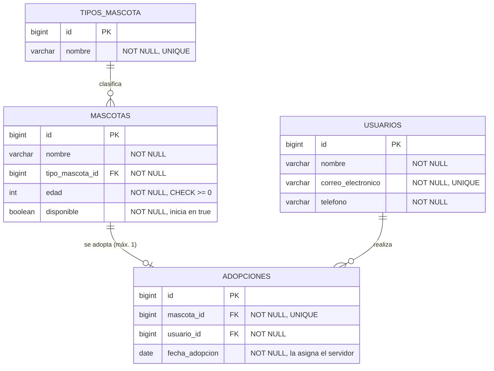

# API-REST-AdopcionCodigoFacilito

API REST para gestionar la adopción de mascotas: registro de mascotas y usuarios adoptantes, consulta de mascotas disponibles y registro de adopciones con reglas de negocio, seguridad HTTP Basic, documentación OpenAPI y pruebas automatizadas.

Proyecto final del Bootcamp de Backend con Java y Spring de Código Facilito.

## Objetivos

- Exponer una API REST organizada en capas, con DTOs de entrada y salida y sin exponer entidades JPA.
- Aplicar las reglas de adopción de forma consistente, incluso ante solicitudes concurrentes.
- Proteger la API con HTTP Basic y dos roles (`USER` y `ADMIN`).
- Responder con códigos HTTP correctos y un formato de error único.
- Documentar la API con OpenAPI/Swagger UI y monitorearla con Actuator.
- Verificar el comportamiento con pruebas unitarias, de controller y de integración.

## Tecnologías

| Componente | Versión |
|---|---|
| Java | 21 (probado con 21.0.6) |
| Spring Boot | 4.1.2 |
| Spring Framework | 7.0.10 |
| Spring Security | 7.1.2 |
| Hibernate ORM / Spring Data JPA | 7.4.13.Final |
| Hibernate Validator (Jakarta Bean Validation) | 9.1.5.Final |
| H2 Database | 2.4.240 |
| springdoc-openapi (Swagger UI 5.34.0) | 3.2.0 |
| Jackson | 3.1.7 |
| Tomcat embebido | 11.0.27 |
| JUnit Jupiter / Mockito | 6.0.3 / 5.23.0 |
| Maven (mediante Maven Wrapper) | 3.9.16 |

## Requisitos

- **JDK 21** instalado y disponible (`java -version`).
- **No hace falta instalar Maven**: el proyecto incluye Maven Wrapper (`mvnw` para Git Bash, `mvnw.cmd` para PowerShell/CMD), que descarga Maven 3.9.16 la primera vez.

> En Windows, `mvnw.cmd` necesita que `powershell.exe` esté en el `PATH`. Si aparece
> `"powershell" no se reconoce como un comando...` o `Cannot start maven from wrapper`, ver
> [Problemas conocidos en Windows](#problemas-conocidos-en-windows).

## Arquitectura

```
com.codigofacilito.adopcion
├── config       Seguridad, OpenAPI, Clock y propiedades de las cuentas de acceso
├── controller   Solo HTTP: valida la entrada, delega en el servicio y arma la respuesta
├── service      Reglas de negocio y transacciones
├── repository   Interfaces Spring Data JPA
├── entity       Entidades JPA
├── dto          Records de request/response y ErrorResponse
├── mapper       Conversión entidad <-> DTO
└── exception    Excepciones de negocio y @RestControllerAdvice
```

Flujo: **HTTP → Controller → Service → Repository → Base de datos**. Los controllers nunca acceden a repositories; toda la lógica de negocio vive en los servicios. Se usa inyección por constructor en todas las capas.

## Modelo de datos



- `Mascota → TipoMascota`, `Adopcion → Mascota` y `Adopcion → Usuario` son relaciones `@ManyToOne`.
- La restricción **UNIQUE sobre `adopciones.mascota_id`** impide que una mascota tenga más de una adopción, aunque se omita la validación del servicio.
- Los correos se guardan en minúsculas y sin espacios en los extremos, así la unicidad no distingue mayúsculas.
- Las claves foráneas no tienen borrado en cascada: la base de datos también impide borrar mascotas o usuarios con adopciones.
- Al iniciar se cargan los tipos de mascota desde `data.sql`: **1 Perro, 2 Gato, 3 Conejo, 4 Ave**.

### Reglas de negocio

| Regla | Implementación | HTTP |
|---|---|---|
| No adoptar mascotas o usuarios inexistentes | Búsqueda previa en el servicio | 404 |
| No adoptar mascotas no disponibles | Verificación después de bloquear la mascota | 409 |
| Adopción y `disponible = false` atómicas | Un único método `@Transactional` | — |
| Adopciones concurrentes | Bloqueo pesimista (`SELECT ... FOR UPDATE`) + UNIQUE en BD | 409 |
| Un PUT no puede reactivar una mascota adoptada | Verificación en el servicio con la mascota bloqueada | 409 |
| No eliminar mascotas o usuarios con adopciones | Verificación en el servicio + clave foránea | 409 |
| Correos únicos sin distinguir mayúsculas | Normalización + verificación + UNIQUE en BD | 409 |

## Ejecución

### Desde IntelliJ IDEA

1. **File → Open** y elegir la carpeta del proyecto (la que contiene `pom.xml`). Aceptar la importación de Maven.
2. **File → Project Structure → Project → SDK**: seleccionar un JDK 21.
3. Abrir `src/main/java/com/codigofacilito/adopcion/AdopcionApplication.java` y pulsar ▶ junto a `main`.
4. La API queda en `http://localhost:8080` con el perfil `dev` (es el perfil por defecto).

Para usar otras credenciales: **Run → Edit Configurations → Environment variables**, por ejemplo
`APP_USER_NAME=operador;APP_USER_PASSWORD=...;APP_ADMIN_NAME=jefe;APP_ADMIN_PASSWORD=...`.

### Desde la terminal

| Acción | PowerShell | Git Bash |
|---|---|---|
| Ejecutar la API (perfil `dev`) | `.\mvnw.cmd spring-boot:run` | `./mvnw spring-boot:run` |
| Pruebas unitarias y de controller | `.\mvnw.cmd clean test` | `./mvnw clean test` |
| Todas las pruebas (incluye integración) | `.\mvnw.cmd clean verify` | `./mvnw clean verify` |
| Generar el JAR | `.\mvnw.cmd clean package` | `./mvnw clean package` |
| Ejecutar el JAR | `java -jar target\adopcion-0.0.1-SNAPSHOT.jar` | `java -jar target/adopcion-0.0.1-SNAPSHOT.jar` |

Para detener la aplicación: `Ctrl + C` en la terminal donde se está ejecutando.

> ⚠️ **Los datos no se conservan.** H2 corre en memoria y Hibernate usa `ddl-auto=create-drop`:
> al reiniciar la aplicación se pierden todos los registros y solo se recargan los tipos de mascota.
> Por eso, con la aplicación recién iniciada, los ids de mascotas, usuarios y adopciones empiezan en 1.

## Perfiles y credenciales

| Perfil | Cuándo se usa | Base de datos | Consola H2 | Cuentas de acceso |
|---|---|---|---|---|
| `dev` | Por defecto al ejecutar localmente | H2 en memoria `jdbc:h2:mem:adopciondb` | Habilitada (solo ADMIN) | Valores de demostración o variables de entorno |
| `test` | Automáticamente en las pruebas | H2 en memoria con nombre aleatorio por contexto | Deshabilitada | `test-user` / `test-admin` (solo pruebas) |
| Otro (ej. `prod`) | `--spring.profiles.active=prod` | H2 en memoria | Deshabilitada | **Obligatorio** definir las variables de entorno |

Las **cuentas de acceso** autentican a quien opera la API (por ejemplo, el personal del refugio). **No son los usuarios adoptantes**: estos son datos de la entidad `Usuario` y no tienen contraseña.

| Variable de entorno | Valor de demostración en `dev` | Rol |
|---|---|---|
| `APP_USER_NAME` / `APP_USER_PASSWORD` | `user` / `user123` | `USER` |
| `APP_ADMIN_NAME` / `APP_ADMIN_PASSWORD` | `admin` / `admin123` | `USER` y `ADMIN` |

- Los valores de demostración **solo existen en el perfil `dev`** y son exclusivamente para uso local.
- Fuera de `dev` no hay valores por defecto: si falta alguna variable, la aplicación no arranca e indica cuál.
- Las contraseñas se codifican con BCrypt (`PasswordEncoder`) al iniciar; nunca se guardan en texto plano.

Ejemplo con credenciales propias y un perfil distinto de `dev`:

```powershell
# PowerShell
$env:APP_USER_NAME = "operador"; $env:APP_USER_PASSWORD = "una-clave-segura"
$env:APP_ADMIN_NAME = "jefe";    $env:APP_ADMIN_PASSWORD = "otra-clave-segura"
java -jar target\adopcion-0.0.1-SNAPSHOT.jar --spring.profiles.active=prod
```

```bash
# Git Bash
APP_USER_NAME=operador APP_USER_PASSWORD=una-clave-segura \
APP_ADMIN_NAME=jefe APP_ADMIN_PASSWORD=otra-clave-segura \
java -jar target/adopcion-0.0.1-SNAPSHOT.jar --spring.profiles.active=prod
```

## Endpoints

Todos los endpoints `/api/**` requieren HTTP Basic. `401` = credenciales ausentes o incorrectas; `403` = la cuenta no tiene el rol requerido.

| Método | Ruta | Rol | Éxito | Errores |
|---|---|---|---|---|
| POST | `/api/mascotas` | ADMIN | 201 + `Location` | 400, 401, 403, 404 (tipo inexistente) |
| GET | `/api/mascotas` | USER o ADMIN | 200 (solo disponibles) | 401 |
| GET | `/api/mascotas/{id}` | USER o ADMIN | 200 | 400, 401, 404 |
| PUT | `/api/mascotas/{id}` | ADMIN | 200 | 400, 401, 403, 404, 409 (reactivar adoptada) |
| DELETE | `/api/mascotas/{id}` | ADMIN | 204 | 401, 403, 404, 409 (tiene adopción) |
| POST | `/api/usuarios` | USER o ADMIN | 201 + `Location` | 400, 401, 409 (correo duplicado) |
| GET | `/api/usuarios` | USER o ADMIN | 200 | 401 |
| GET | `/api/usuarios/{id}` | USER o ADMIN | 200 | 400, 401, 404 |
| PUT | `/api/usuarios/{id}` | USER o ADMIN | 200 | 400, 401, 404, 409 (correo de otro usuario) |
| DELETE | `/api/usuarios/{id}` | ADMIN | 204 | 401, 403, 404, 409 (tiene adopciones) |
| POST | `/api/adopciones` | USER o ADMIN | 201 + `Location` | 400, 401, 404, 409 (no disponible) |
| GET | `/api/adopciones/{id}` | USER o ADMIN | 200 | 400, 401, 404 |

Los endpoints `GET /api/mascotas/{id}` y `GET /api/adopciones/{id}` existen para que el header `Location` de los `201` apunte a un recurso consultable. Cualquier error inesperado responde `500` sin detalles internos.

### Formato de error

Todas las respuestas de error, incluidas `401` y `403`, usan el mismo formato:

```json
{
  "timestamp": "2026-10-27T16:27:51.181557600Z",
  "status": 400,
  "error": "Bad Request",
  "message": "La solicitud contiene datos inválidos",
  "path": "/api/usuarios",
  "details": [
    { "field": "correoElectronico", "message": "El correo electrónico no tiene un formato válido" },
    { "field": "telefono", "message": "El teléfono debe tener entre 7 y 20 caracteres: dígitos, espacios, paréntesis, guiones y un + inicial opcional" },
    { "field": "nombre", "message": "El nombre es obligatorio" }
  ]
}
```

`details` solo tiene contenido en errores de validación; en los demás casos es una lista vacía. Nunca se envían trazas de excepciones al cliente.

## Ejemplos con curl

Los cuerpos de las solicitudes están en la carpeta [`ejemplos/`](ejemplos) y se envían con `--data-binary "@archivo"`. Así los mismos comandos funcionan en Git Bash y en PowerShell sin problemas de comillas.

- **Git Bash:** usar `curl`.
- **PowerShell:** usar **`curl.exe`**. En Windows PowerShell 5.1, `curl` es un alias de `Invoke-WebRequest` y no acepta estas opciones. Escribir `"@ejemplos/..."` entre comillas, porque `@` tiene significado especial en PowerShell.

Todos los comandos se ejecutan desde la carpeta raíz del proyecto, con la aplicación iniciada en el perfil `dev` y recién arrancada.

### Demostración completa

**1. Registrar un usuario adoptante** (`ejemplos/usuario.json`)

```bash
# Git Bash
curl -i -u user:user123 -H "Content-Type: application/json" --data-binary @ejemplos/usuario.json http://localhost:8080/api/usuarios
```

```powershell
# PowerShell
curl.exe -i -u user:user123 -H "Content-Type: application/json" --data-binary "@ejemplos/usuario.json" http://localhost:8080/api/usuarios
```

```http
HTTP/1.1 201
Location: http://localhost:8080/api/usuarios/1
Content-Type: application/json

{"id":1,"nombre":"Ana Pérez","correoElectronico":"ana.perez@mail.com","telefono":"+54 11 5555-1234"}
```

**2. Registrar una mascota** (requiere ADMIN; `ejemplos/mascota.json`)

```bash
# Git Bash
curl -i -u admin:admin123 -H "Content-Type: application/json" --data-binary @ejemplos/mascota.json http://localhost:8080/api/mascotas
```

```powershell
# PowerShell
curl.exe -i -u admin:admin123 -H "Content-Type: application/json" --data-binary "@ejemplos/mascota.json" http://localhost:8080/api/mascotas
```

```http
HTTP/1.1 201
Location: http://localhost:8080/api/mascotas/1
Content-Type: application/json

{"id":1,"nombre":"Firulais","tipoMascota":{"id":1,"nombre":"Perro"},"edad":3,"disponible":true}
```

**3. Consultar las mascotas disponibles**

```bash
curl -u user:user123 http://localhost:8080/api/mascotas          # Git Bash
curl.exe -u user:user123 http://localhost:8080/api/mascotas      # PowerShell
```

```json
[{"id":1,"nombre":"Firulais","tipoMascota":{"id":1,"nombre":"Perro"},"edad":3,"disponible":true}]
```

**4. Adoptar la mascota** (`ejemplos/adopcion.json`: `{"mascotaId": 1, "usuarioId": 1}`)

```bash
# Git Bash
curl -i -u user:user123 -H "Content-Type: application/json" --data-binary @ejemplos/adopcion.json http://localhost:8080/api/adopciones
```

```powershell
# PowerShell
curl.exe -i -u user:user123 -H "Content-Type: application/json" --data-binary "@ejemplos/adopcion.json" http://localhost:8080/api/adopciones
```

```http
HTTP/1.1 201
Location: http://localhost:8080/api/adopciones/1
Content-Type: application/json

{"id":1,"fechaAdopcion":"2026-10-27","mascota":{"id":1,"nombre":"Firulais","tipoMascota":{"id":1,"nombre":"Perro"},"edad":3,"disponible":false},"usuario":{"id":1,"nombre":"Ana Pérez","correoElectronico":"ana.perez@mail.com","telefono":"+54 11 5555-1234"}}
```

**5. Comprobar que ya no aparece entre las disponibles**

```bash
curl -u user:user123 http://localhost:8080/api/mascotas          # Git Bash
curl.exe -u user:user123 http://localhost:8080/api/mascotas      # PowerShell
```

```json
[]
```

**6. Intentar adoptarla otra vez** (mismo comando del paso 4)

```http
HTTP/1.1 409

{"timestamp":"2026-10-27T16:27:50.974875500Z","status":409,"error":"Conflict","message":"La mascota con id 1 ya fue adoptada o no está disponible","path":"/api/adopciones","details":[]}
```

### Otros ejemplos

Los comandos usan la sintaxis de Git Bash. En PowerShell, reemplazar `curl` por `curl.exe` y escribir el archivo como `"@ejemplos/..."`.

| Caso | Comando | Respuesta |
|---|---|---|
| Sin credenciales | `curl -i http://localhost:8080/api/mascotas` | `401` + `WWW-Authenticate: Basic realm="adopcion-api"` |
| Rol insuficiente | `curl -i -u user:user123 -H "Content-Type: application/json" --data-binary @ejemplos/mascota.json http://localhost:8080/api/mascotas` | `403` |
| Datos inválidos | `curl -i -u user:user123 -H "Content-Type: application/json" --data-binary @ejemplos/usuario-invalido.json http://localhost:8080/api/usuarios` | `400` con `details` |
| Correo duplicado | repetir el paso 1 | `409` |
| Reactivar una adoptada | `curl -i -u admin:admin123 -X PUT -H "Content-Type: application/json" --data-binary @ejemplos/mascota-reactivar.json http://localhost:8080/api/mascotas/1` | `409` |
| Actualizar una mascota | `curl -i -u admin:admin123 -X PUT -H "Content-Type: application/json" --data-binary @ejemplos/mascota-actualizacion.json http://localhost:8080/api/mascotas/{id}` | `200` |
| Listar usuarios | `curl -u user:user123 http://localhost:8080/api/usuarios` | `200` |
| Consultar un usuario | `curl -u user:user123 http://localhost:8080/api/usuarios/1` | `200` |
| Actualizar un usuario | `curl -i -u user:user123 -X PUT -H "Content-Type: application/json" --data-binary @ejemplos/usuario-actualizacion.json http://localhost:8080/api/usuarios/1` | `200` |
| Consultar una adopción | `curl -u user:user123 http://localhost:8080/api/adopciones/1` | `200` |
| Recurso inexistente | `curl -i -u user:user123 http://localhost:8080/api/mascotas/99` | `404` |
| Eliminar una mascota con adopción | `curl -i -u admin:admin123 -X DELETE http://localhost:8080/api/mascotas/1` | `409` |
| Eliminar una mascota sin adopción | `curl -i -u admin:admin123 -X DELETE http://localhost:8080/api/mascotas/{id}` | `204` |
| Eliminar un usuario con adopciones | `curl -i -u admin:admin123 -X DELETE http://localhost:8080/api/usuarios/1` | `409` |
| Eliminar usuario con rol USER | `curl -i -u user:user123 -X DELETE http://localhost:8080/api/usuarios/1` | `403` |

Respuesta de `PUT /api/usuarios/1` con `ejemplos/usuario-actualizacion.json`:

```json
{"id":1,"nombre":"Ana María Pérez","correoElectronico":"ana.perez@mail.com","telefono":"+54 11 4444-0000"}
```

## Swagger UI y OpenAPI

| Recurso | URL | Acceso |
|---|---|---|
| Swagger UI | <http://localhost:8080/swagger-ui.html> (redirige a `/swagger-ui/index.html`) | Público |
| Documento OpenAPI (JSON) | <http://localhost:8080/v3/api-docs> | Público |

La documentación es pública, pero **los endpoints de negocio siguen protegidos**: Swagger UI solo envía las credenciales que se cargan con **Authorize**. Cada operación indica en su descripción el rol requerido (`USER` o `ADMIN`) y documenta sus respuestas de error con el esquema `ErrorResponse`.

Para probar la API desde Swagger UI:

1. Abrir <http://localhost:8080/swagger-ui.html>.
2. Pulsar **Authorize** (candado arriba a la derecha).
3. En `basicAuth (http, Basic)` escribir `user` / `user123` (o `admin` / `admin123` para operaciones de ADMIN) y pulsar **Authorize** y luego **Close**.
4. Expandir una operación, pulsar **Try it out**, completar el cuerpo y pulsar **Execute**.
5. Para cambiar de cuenta: **Authorize → Logout** y volver a autorizar.

> Autorizar **antes** de usar *Try it out*. Si se ejecuta una operación sin autorizar, el navegador
> puede mostrar su propio diálogo de usuario y contraseña (por el header `WWW-Authenticate`).
> Conviene **cancelarlo** y usar Authorize: ver la [limitación de CSRF](#http-basic-https-y-csrf).

## Actuator

Solo se exponen por HTTP `health` e `info`, ambos públicos:

| URL | Respuesta |
|---|---|
| <http://localhost:8080/actuator/health> | `{"status":"UP"}` (sin componentes ni detalles internos) |
| <http://localhost:8080/actuator/info> | `{"app":{"name":"API-REST-AdopcionCodigoFacilito","description":"API REST para la adopción de mascotas","version":"0.0.1-SNAPSHOT"}}` |

Los demás endpoints (`env`, `beans`, `mappings`, `heapdump`, `configprops`, `loggers`, `metrics`, etc.) no están expuestos, y además la seguridad los rechaza (`401` sin credenciales, `403` con credenciales). El nombre y la versión de `info` se toman del `pom.xml` al compilar.

## Consola H2

Disponible solo en el perfil `dev`:

1. Abrir <http://localhost:8080/h2-console>. El navegador pide credenciales: usar la cuenta **ADMIN** (`admin` / `admin123`).
2. En el formulario de H2:
   - **JDBC URL:** `jdbc:h2:mem:adopciondb`
   - **User Name:** `sa`
   - **Password:** (vacío)
3. Pulsar **Connect**. Consultas útiles:

```sql
SELECT * FROM TIPOS_MASCOTA;
SELECT * FROM MASCOTAS;
SELECT * FROM USUARIOS;
SELECT * FROM ADOPCIONES;
```

La consola tiene su propia cadena de seguridad que exige el rol ADMIN. Solo para sus rutas se permite que el sitio se muestre en frames del mismo origen y se desactiva CSRF, porque la consola usa formularios y frames propios. Con la cuenta USER responde `403`, y en los perfiles distintos de `dev` no existe.

## HTTP Basic, HTTPS y CSRF

- **HTTP Basic no cifra las credenciales**: solo las codifica en Base64 en el header `Authorization`, así que cualquiera que intercepte el tráfico puede leerlas. **Fuera del entorno local es obligatorio usar HTTPS.** Esta configuración sirve solo para desarrollo y evaluación.
- La API no usa sesión HTTP (`STATELESS`): cada solicitud debe incluir sus credenciales.
- **CSRF está desactivado en `/api/**`.** La API está pensada para **clientes que envían el header `Authorization` de forma explícita** en cada solicitud: curl, Postman, Swagger UI (con Authorize) u otro backend. Un sitio externo no puede agregar ese header por cuenta del usuario.
- **Limitación en navegadores:** `STATELESS` por sí solo **no elimina** el riesgo de CSRF. Si alguien se autentica con el diálogo nativo del navegador, este guarda las credenciales Basic y las reenvía automáticamente, también en solicitudes iniciadas desde otro sitio. Por eso la API no debe usarse desde un navegador con ese diálogo. Un frontend web propio requeriría reactivar CSRF o migrar a tokens enviados explícitamente (por ejemplo JWT u OAuth2).

## Pruebas

| Tipo | Ubicación | Herramientas | Fase de Maven |
|---|---|---|---|
| Unitarias de servicio | `src/test/java/.../service` (`*Test`) | JUnit + Mockito, sin Spring | `test` (Surefire) |
| Controllers | `src/test/java/.../controller` (`*Test`) | `@WebMvcTest` + MockMvc + seguridad real, servicios simulados | `test` (Surefire) |
| Integración | `src/test/java/.../integration` (`*IT`) | `@SpringBootTest` + H2, sin mocks; `@DataJpaTest` para restricciones | `integration-test` (Failsafe) |

```powershell
.\mvnw.cmd clean test      # PowerShell: unitarias y de controller
.\mvnw.cmd clean verify    # PowerShell: todas, incluidas las de integración
```

```bash
./mvnw clean test          # Git Bash
./mvnw clean verify
```

Las pruebas de integración cubren, entre otras cosas:

- que una adopción cambia `disponible` a `false` y que `GET /api/mascotas` la excluye;
- que una mascota no se adopta dos veces;
- que un fallo dentro de la transacción revierte la adopción y la disponibilidad;
- que dos solicitudes concurrentes producen exactamente un `201`, un `409` y una sola adopción en la base;
- la documentación OpenAPI, Swagger UI y Actuator.

Las pruebas usan el perfil `test`, que tiene sus propias credenciales y una base H2 independiente.

**Reportes:**

- Surefire (unitarias y de controller): `target/surefire-reports/`
- Failsafe (integración): `target/failsafe-reports/`

Cada clase genera un archivo `.txt` con el resumen y un `.xml` con el detalle.

**Desde IntelliJ:** en la ventana **Maven → Lifecycle**, ejecutar `test` o `verify`. También se puede usar clic derecho sobre un paquete de `src/test/java` → **Run Tests**; al ejecutar todo `src/test/java` así, IntelliJ corre juntas las pruebas `*Test` y `*IT`. Si al lanzar pruebas desde el IDE aparece un error relacionado con `-javaagent`, desmarcar **argLine** en *Settings → Build, Execution, Deployment → Build Tools → Maven → Running Tests*.

## Problemas conocidos en Windows

### `mvnw.cmd` no encuentra PowerShell

Si el `PATH` del sistema no incluye las carpetas estándar de Windows, `mvnw.cmd` falla con
`"powershell" no se reconoce como un comando interno o externo` y `Cannot start maven from wrapper`.
En ese caso tampoco se encuentra `curl.exe`.

**Solución temporal** (afecta solo a la terminal actual; no modifica la configuración del sistema):

```powershell
# PowerShell
$env:Path = "$env:SystemRoot\System32;$env:SystemRoot;$env:SystemRoot\System32\WindowsPowerShell\v1.0;$env:Path"
```

```bat
:: CMD
set "PATH=%SystemRoot%\System32;%SystemRoot%;%SystemRoot%\System32\WindowsPowerShell\v1.0;%PATH%"
```

Otra alternativa es usar Git Bash con `./mvnw`, que no depende de PowerShell. La solución definitiva es restaurar esas carpetas en la variable `Path` del sistema.

### Caracteres acentuados en la consola

La API responde en UTF-8. Si en PowerShell o CMD se ven caracteres como `ó` en lugar de `ó`, el problema está en la página de códigos de la consola, no en la respuesta. En Git Bash, Swagger UI o el navegador se ven correctamente.
